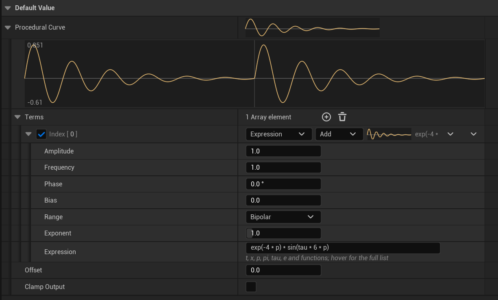
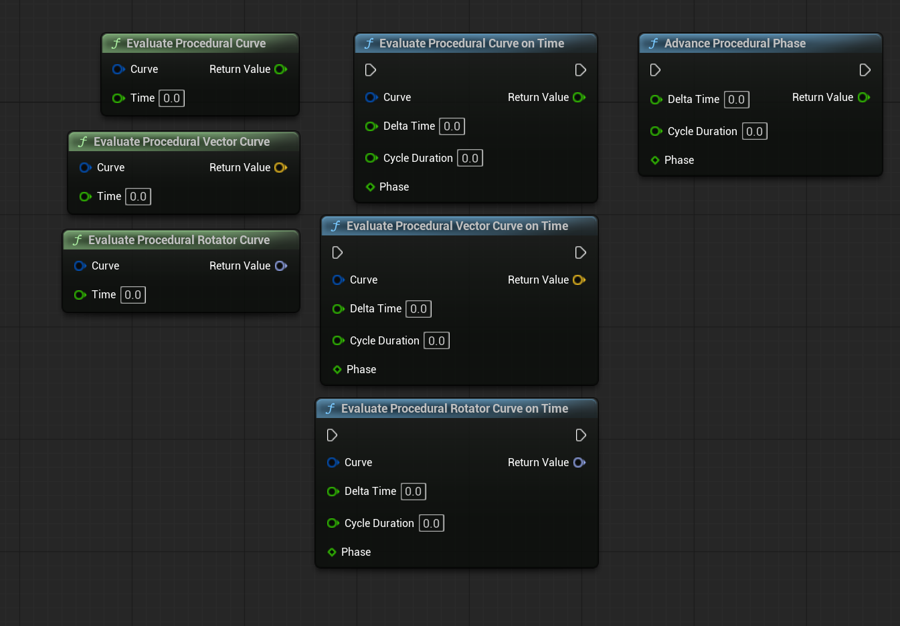
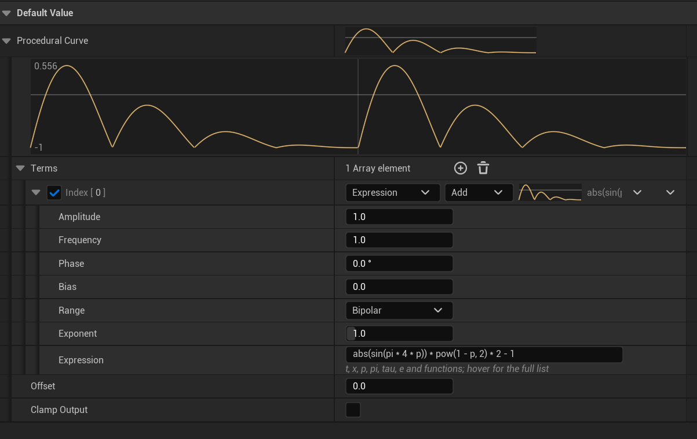
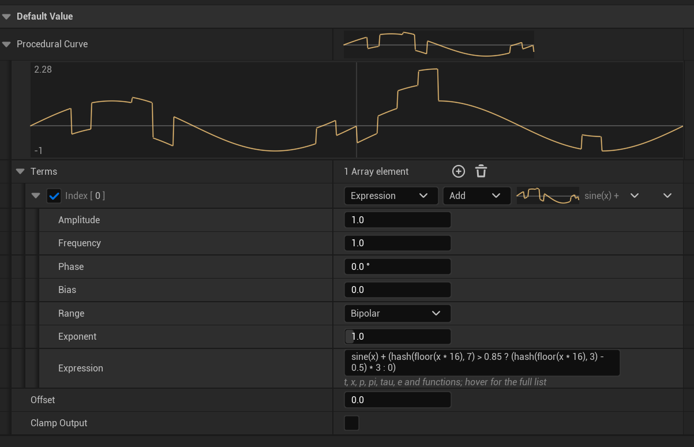
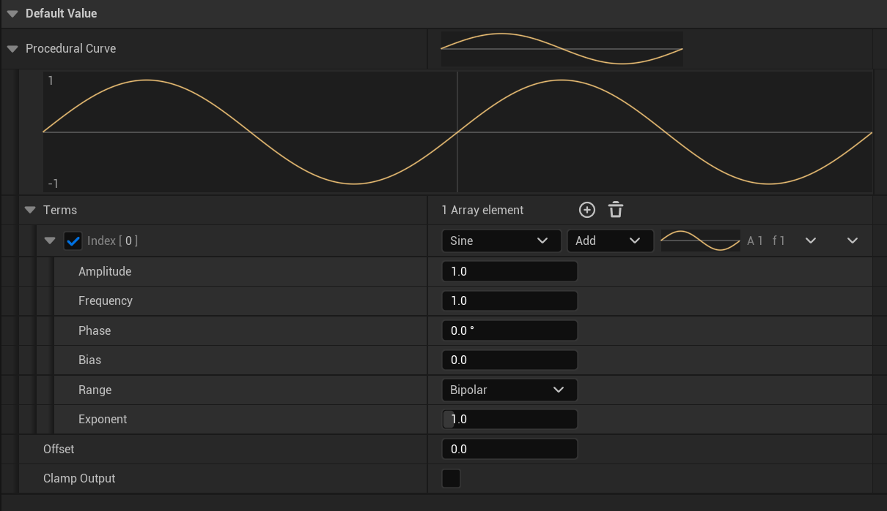
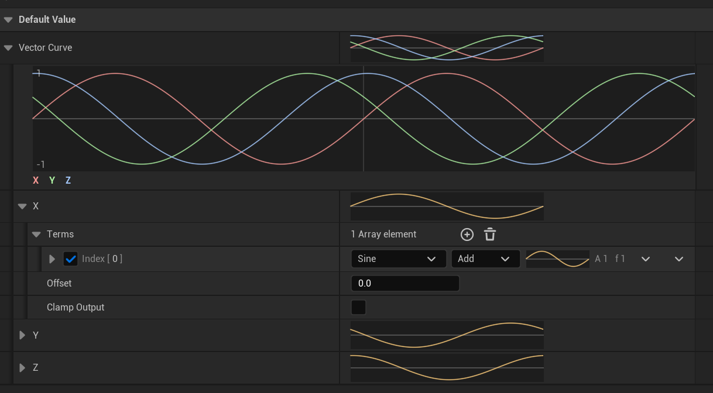
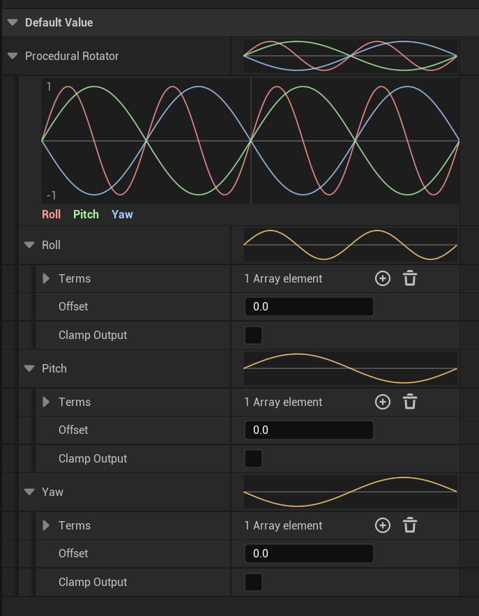

# ProceduralCurves

[English](README.md) | **Русский**

Кривые для Unreal Engine 5, заданные формулой. Вместо ключей кривая состоит из волн и математических выражений, вычисляется непрерывно в любой момент времени и из любого потока, а в Details panel видна живым графиком.



## Обзор

**ProceduralCurves** добавляет `FProceduralCurve`: смещение плюс упорядоченный список слагаемых. Каждое слагаемое задаёт волну (синус, треугольник, меандр, пилу, отскок, шум, ступенчатый шум или формулу) с амплитудой, частотой, фазой, смещением и формой. Слагаемые прибавляются к результату или умножают его, поэтому огибающие, модуляция и многослойное движение занимают несколько строк вместо сотен ключей.

Где пригодится: покачивание оружия и head bob, дыхание в idle, мерцание света, пульсация UI, тряска камеры, процедурная отдача и вообще всё периодическое или шумное, что аниматор хочет настраивать числами, а не ключами.

**Возможности:**
- Структуры `FProceduralCurve`, `FProceduralVectorCurve` и `FProceduralRotatorCurve`. Обычные данные: работают в Data Asset, Blueprint, SaveGame и репликации
- Восемь форм волны со скосом, скважностью, сглаживанием, экспонентой и униполярным диапазоном
- Сложение и умножение слагаемых
- Формулы компилируются в стековую программу, около 40 функций, кэш по тексту формулы
- Кастомизация Details panel: график в заголовке, предпросмотр на два цикла с подписями диапазона и предупреждением о шве, проверка формулы на лету
- Потокобезопасное вычисление, runtime не зависит от editor-модулей

## Установка

Склонировать или скачать исходники в папку `Plugins/` проекта, перегенерировать project files и включить плагин в `.uproject` или через Edit > Plugins.

**Модули:**

| Модуль | Тип | Назначение |
|--------|-----|------------|
| `ProceduralCurves` | Runtime | Структуры кривых, волны, компилятор формул, Blueprint-библиотека |
| `ProceduralCurvesEditor` | Editor | Кастомизация Details panel и графики |

## Быстрый старт

### Details panel

1. Добавить свойство `FProceduralCurve` (или `FProceduralVectorCurve`, `FProceduralRotatorCurve`) в любой класс, структуру или Data Asset
2. Добавить слагаемые, выбрать каждому форму волны, задать Amplitude, Frequency и Phase
3. График обновляется по мере правки

```cpp
UPROPERTY(EditAnywhere, Category = "Sway")
FProceduralVectorCurve Sway;
```

### Blueprint: проигрывание во времени

**Evaluate Procedural Curve On Time** сдвигает фазу на `DeltaTime / CycleDuration` и вычисляет кривую в ней. При `CycleDuration = 3` кривая проходит полный цикл за 3 секунды при любом FPS. `Phase` хранить в float-переменной.

| Функция | Назначение |
|---------|------------|
| `EvaluateProceduralCurve` | Значение в заданный момент |
| `EvaluateProceduralVectorCurve` | Вектор в заданный момент |
| `EvaluateProceduralRotatorCurve` | Ротатор в заданный момент |
| `EvaluateProceduralCurveOnTime` | Сдвинуть фазу и вычислить |
| `EvaluateProceduralVectorCurveOnTime` | То же для вектора |
| `EvaluateProceduralRotatorCurveOnTime` | То же для ротатора |
| `AdvanceProceduralPhase` | Только сдвинуть и свернуть фазу |

Все функции потокобезопасны и вызываются из thread-safe функций Animation Blueprint.



### C++

```cpp
#include "ProceduralCurve.h"
#include "ProceduralCurveLibrary.h"

// Bob: синус 2x и более острый удар 4x, записанные как данные.
FProceduralCurve Bob;
Bob.AddSine(0.6f, 2.0f, 270.0f)
   .AddSine(0.07f, 4.0f, 270.0f);

// Огибающая дыхания, умножающая всё, что выше.
FProceduralCurveTerm& Breath = Bob.Terms.AddDefaulted_GetRef();
Breath.Blend = EProceduralTermBlend::Multiply;
Breath.Bias = 1.0f;
Breath.Amplitude = 0.2f;

// Один цикл за 1.2 секунды, независимо от FPS.
float Phase = 0.0f;
const float Value = UProceduralCurveLibrary::EvaluateProceduralCurveOnTime(Bob, DeltaTime, 1.2f, Phase);
```

## Слагаемые

Каждое слагаемое считает `Bias + Amplitude * shape(waveform(x))`, где `x = Frequency * Time + Phase / 360` измеряется в циклах. Слагаемые применяются сверху вниз: **Add** прибавляет к результату, **Multiply** умножает всё, что выше. В конце прибавляется `Offset`, затем применяется необязательный clamp выхода.

| Форма | Как выглядит | Параметры |
|-------|--------------|-----------|
| Sine | Обычный синус | |
| Triangle | Линейно вверх и вниз | `Skew`: позиция пика; 0 или 1 дают пилу |
| Square | Высокий уровень часть цикла | `Duty`: доля высокого уровня; `Smoothing`: скруглённые переходы |
| Sawtooth | Подъём и сброс | `Smoothing`: скруглённый сброс |
| Bounce | Выпрямленный синус | |
| Noise | Плавные случайные значения | `Seed`; узлов на единицу времени = `Frequency` |
| SteppedNoise | Случайные значения, удерживаемые между узлами | `Seed`, `Smoothing` |
| Expression | Формула | `Expression` |

**Форма, для любой волны:**
- `Range`: Bipolar оставляет `[-1, 1]`, Unipolar переводит в `[0, 1]` (импульсы, огибающие)
- `Exponent`: степень со знаком, больше 1 заостряет пики, меньше 1 тянет к меандру
- `Bias`: прибавляется после амплитуды; Multiply-слагаемое с Bias 1 и Amplitude 0.2 масштабирует на 0.8..1.2
- `bEnabled`: выключить слагаемое, не удаляя

Любая периодическая волна повторяется на каждом целом `x` и, если не сказано иное, проходит через ноль вверх при `x = 0`, как синус. Шум повторяется каждые `round(Frequency)` узлов, поэтому целые частоты зацикливаются без шва на единице времени.

## Формулы

Поставить слагаемому форму **Expression** и вписать формулу. Её результат и есть значение волны: Amplitude, Bias, Exponent и Range применяются как обычно. Ошибки появляются под полем прямо при наборе, с позицией проблемы.

**Переменные:** `t` (время кривой), `x` (`Frequency * t + Phase / 360`, в циклах), `p` (`frac(x)`, позиция внутри цикла)
**Константы:** `pi`, `tau`, `e`
**Операторы:** `+ - * / % ^` (степень, правоассоциативная), унарные `-` и `!`, `< <= > >= == !=`, `&& ||`, `c ? a : b`

| Группа | Функции |
|--------|---------|
| Тригонометрия | `sin cos tan asin acos atan atan2` |
| Округление | `abs sign floor ceil round frac` |
| Степени | `sqrt exp log log2 pow` |
| Диапазоны | `min max mod clamp saturate lerp remap select` |
| Сглаживание | `step smoothstep smootherstep` |
| Волны | `sine tri square saw bounce` (период 1, те же параметры, что у форм слагаемых) |
| Шум | `noise pnoise snoise hash` |

Деление, остаток, `sqrt` и `log` от недопустимого аргумента дают 0, а не NaN. Имена нечувствительны к регистру. Все сигнатуры видны во всплывающей подсказке под полем формулы.

**Примеры:**


Затухающие отскоки:



Синус с редкими случайными сбоями, `sine(x) + (hash(floor(x * 16), 7) > 0.85 ? (hash(floor(x * 16), 3) - 0.5) * 3 : 0)`:



## Details panel

- **Заголовок кривой:** график одного цикла
- **Тело кривой:** график на два цикла с подписями min и max; красная метка и предупреждение, если на шве цикла значение прыгает
- **Вектор- и ротатор-кривые:** X, Y и Z (или Roll, Pitch и Yaw) на одном графике красным, зелёным и синим
- **Заголовок слагаемого:** галочка включения, форма, режим, мини-график и сводка в одну строку (`A 0.4   f 2   310°`)
- **Тело слагаемого:** только параметры выбранной формы
- **Поле формулы:** многострочное, проверяется при наборе, полный справочник функций по наведению

Одно синусоидальное слагаемое:



Вектор-кривая со сдвинутыми по фазе X, Y и Z:



Ротатор-кривая, легенда берётся из полей Roll, Pitch и Yaw:



## Архитектура

```
FProceduralCurve (USTRUCT)
├── Terms: TArray<FProceduralCurveTerm>
├── Offset, bClampOutput, OutputMin, OutputMax
├── Evaluate(Time) -> float
└── AddSine() / Add() / Scale()

FProceduralCurveTerm (USTRUCT)
├── Waveform, Blend, Amplitude, Frequency, Phase, Bias
├── Range, Exponent, Skew, Duty, Smoothing, Seed
├── Expression: FString
└── Evaluate(Time) -> float

FProceduralVectorCurve (USTRUCT)
└── X, Y, Z: FProceduralCurve

FProceduralRotatorCurve (USTRUCT)
└── Roll, Pitch, Yaw: FProceduralCurve      // градусы, Evaluate -> FRotator

ProceduralWaves             // математика волн, общая для слагаемых и формул
ProceduralExpression        // токенизатор, компилятор рекурсивным спуском, стековая VM
UProceduralCurveLibrary     // Blueprint-функции и проигрывание, не зависящее от FPS
```

### Как работают формулы

1. **Компиляция:** парсер рекурсивным спуском превращает формулу в плоскую стековую программу и проверяет имена, число аргументов и глубину стека.
2. **Кэш:** программы лежат в общем на процесс кэше по тексту формулы под read-write lock. Формула компилируется один раз, сколько бы кривых, копий и потоков её ни использовали. Скомпилированное в ассеты не сохраняется, поэтому копирование, undo, репликация и структуры, собранные в Blueprint, работают всегда. Каждое слагаемое помнит свою последнюю программу в атомарном указателе, так что неизменная формула вычисляется без хэширования и блокировок; кэш никогда не освобождает программы, и указатель остаётся валидным.
3. **Выполнение:** программа выполняется на стеке фиксированного размера без аллокаций; некорректная формула даёт 0 и пишет ошибку в лог один раз.

## Замечания

- Вычисление потокобезопасно. Правка кривой в Details panel во время PIE, пока её вычисляет animation worker-поток, небезопасна, как и у обычных curve-ассетов.
- Целые частоты зацикливаются без шва на единице времени. Если нет, график отмечает шов.

## Требования

- Unreal Engine 5.0+ (собрано и проверено на 5.6; старые версии покрыты version guards, но сборкой не проверены)

## Лицензия

MIT
